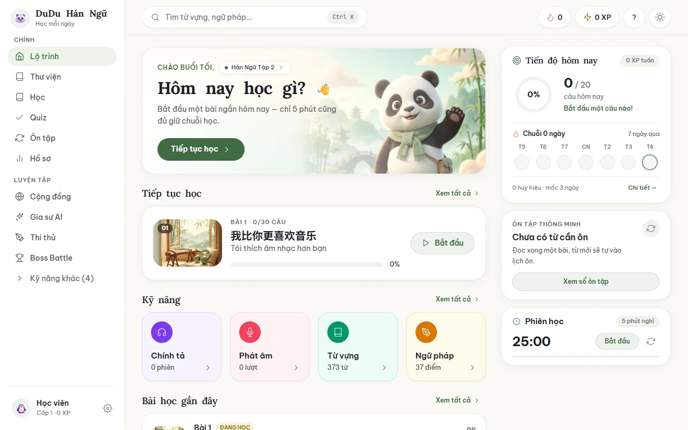
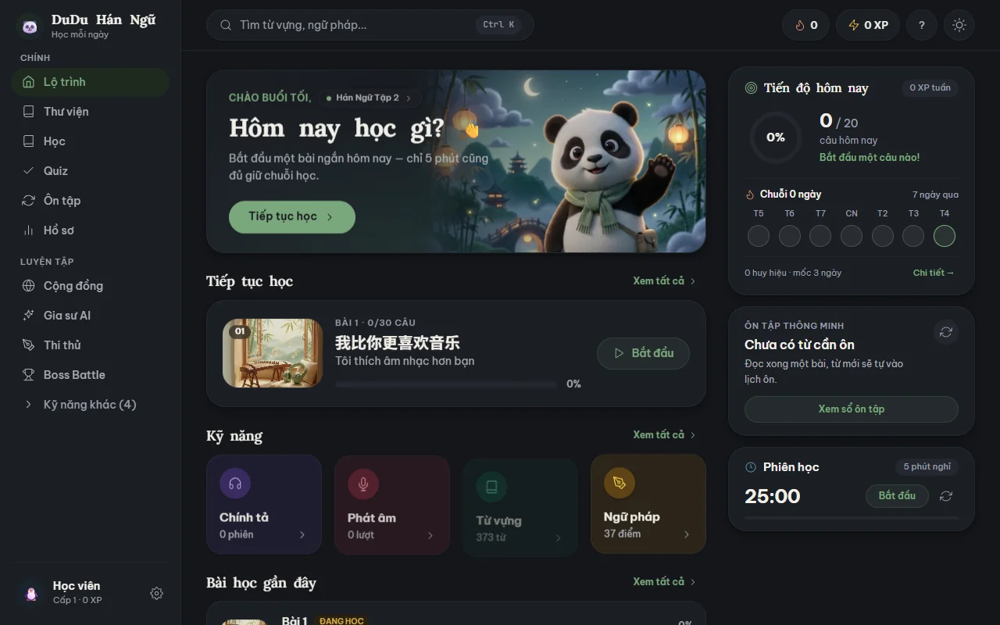

# DuDu Hán Ngữ (Full-Stack)

[](https://github.com/ThanhTu149/DuDuXueXi/actions/workflows/ci.yml)

[](LICENSE)


Ứng dụng web học tiếng Trung full-stack cho sinh viên Việt Nam, xây bằng **React + Vite + Tailwind CSS** ở frontend (hỗ trợ học ngoại tuyến **PWA cache sau lần tải đầu tiên**) và **Node.js + SQLite (`node:sqlite`)** ở backend.

Mười bài giáo trình có sẵn được nạp từ `data/`; khóa học tự tạo, tiến độ học, SRS, ghi chú và hội thoại Gia sư AI được lưu cục bộ trên trình duyệt **và tự động đồng bộ hai chiều lên máy chủ SQLite** khi đăng nhập.

## Giao diện trực quan (Light & Dark Mode)

| Light Mode (Giấy ấm & Xanh rừng) | Dark Mode (Đèn lồng đêm 3D) |
| --- | --- |
|  |  |

## Tính năng Full-Stack mới (v2.0)

- **Tài khoản & Đồng bộ đa thiết bị**: đăng ký/đăng nhập (`scrypt` + cookie phiên `HttpOnly`), quản lý thiết bị đang đăng nhập, 6 mã khôi phục tài khoản dùng một lần (`POST /api/auth/recover`), tự động gộp dữ liệu đã học ở chế độ khách khi đăng nhập lần đầu, hàng đợi đồng bộ khi mất mạng.
- **Kho khóa học Cộng đồng**: chia sẻ khóa học tự tạo kèm thẻ chủ đề & mã chia sẻ, tìm kiếm, xem trước bài học và nhân bản 1 chạm về thư viện cá nhân (kèm 2 khóa học mẫu chính thức).
- **Bảng xếp hạng thực tế**: xếp hạng XP theo tuần (ISO week) và tổng XP mọi thời đại giữa các học viên, có tuỳ chọn ẩn/hiện riêng tư.
- **Gia sư Trúc AI**: trò chuyện hỏi đáp ngữ pháp, sửa câu tiếng Trung và tạo ví dụ theo đúng ngữ cảnh bài đang mở, lưu lịch sử bền vững trong SQLite.
- **Bảo mật & Vận hành Production**: hỗ trợ biến môi trường `GEMINI_API_KEY` dùng chung (giới hạn quota ngày `SERVER_AI_DAILY_LIMIT` / `SERVER_AI_DAILY_CHARS`) hoặc mã hoá key cá nhân bằng **AES-256-GCM** trên server, tự động bật `COOKIE_SECURE` khi `NODE_ENV=production`, chặn gian lận XP bất thường phía server, log JSON kèm `X-Request-Id` và lệnh sao lưu nóng `npm run db:backup`.

Xem chi tiết kiến trúc và toàn bộ REST API tại [docs/FULLSTACK.md](docs/FULLSTACK.md).

## Chạy local (Full-Stack)

Yêu cầu **Node.js >= 22.5** (khuyến nghị Node 24).

```bash
npm install
npm run dev
```

Lệnh `npm run dev` khởi chạy đồng thời:
- Backend API + SQLite tại `http://127.0.0.1:3001` (tự tạo `data/dudu.sqlite`)
- Frontend Vite tại `http://localhost:5173` (tự động proxy `/api/*`)

Tuỳ chọn: sao chép `.env.example` thành `.env` nếu muốn cấu hình `GEMINI_API_KEY`, `ENCRYPTION_KEY`, `PORT` hoặc `DUDU_DB_PATH`.

## Build & chạy production (Full-Stack)

```bash
npm run build
npm start
```

`npm start` phục vụ cả ứng dụng tĩnh đã build trong `dist/` lẫn toàn bộ REST API `/api/*` trên cùng một cổng (`http://127.0.0.1:3001`). Ứng dụng vẫn có thể deploy tĩnh (offline-only) nếu chỉ phục vụ `dist/`.

## Nhập tài liệu và tạo bài học

1. Mở **Thư viện** ở thanh bên, nhập tên rồi chọn **Thêm khóa học**.
2. Chọn PDF có lớp chữ, DOCX hoặc TXT (tối đa 100 MB). Xem trước text và các đoạn, rồi chọn **Lưu tài liệu và tiếp tục**.
3. Trong **Hồ sơ > Cài đặt**, lưu Gemini API key và chọn model. Quay lại Thư viện, chọn **Sinh bài học**.
4. Kiểm tra bản nháp ở **Duyệt nội dung**, sửa/xóa mục cần thiết rồi chọn **Lưu vào khóa học**.

Sau khi bắt đầu sinh bài học, có thể chuyển sang mục khác trong app; thanh tiến độ và nút **Xem tiến độ** vẫn hoạt động. Mỗi đoạn hoàn tất được lưu vào IndexedDB. Nếu tải lại hoặc đóng tab, quá trình không chạy khi trang đã đóng nhưng sẽ tự tiếp tục từ đoạn chưa xong khi mở lại app (trừ khi đã chọn **Tạm dừng** hoặc **Hủy**). Giữ thiết bị có mạng và tab mở để xử lý liên tục.

PDF scan ảnh chưa được hỗ trợ OCR. PDF/DOCX dùng pdf.js và Mammoth tải động từ CDN khi nhập; cần kết nối mạng cho hai định dạng này và cho Gemini. Nội dung gửi Gemini chỉ là text trích xuất, không phải file gốc. API key lưu cục bộ trong IndexedDB; không nhập key trên máy dùng chung. Tốc độ gọi Gemini được giới hạn theo hàng đợi và quota thực tế tùy tài khoản/model.

Trong Thư viện có thể đổi tên, nhân bản, ghép, xóa và xuất/nhập khóa học dạng `.dudu` có checksum. Sao lưu này chứa nội dung khóa học, không chứa tiến độ học. **Hồ sơ > Cài đặt** vẫn có xuất/nhập JSON tiến độ riêng.

## Kiểm thử

```bash
# Chạy toàn bộ 11 bộ kiểm thử Node thuần (gồm lint, test:api, test:pedagogy, storage, backup, PWA, WCAG AA)
npm test

# Kiểm tra cú pháp server/script (node --check), src JSX/ESM (esbuild) và JSON dữ liệu
npm run lint

# Kiểm thử sư phạm (chấm câu 4 chế độ gõ, SM-2 EF & leech, Mastery Gate, chính tả)
npm run test:pedagogy

# Backend Full-Stack API, SQLite, Auth, Sync, Community, Leaderboard, AI Proxy, XP bounds, Backup
npm run test:api

# Dữ liệu, pipeline AI, tiến độ, sao lưu, PWA (node thuần, deterministic)
npm run test:db
npm run test:extractors
npm run test:gemini
npm run test:gemini-retry
npm run test:word-editor
npm run test:content-editor
npm run test:processing
npm run test:processing-jobs
npm run test:background-processing
npm run test:storage
npm run test:db-schema
npm run test:backup
npm run test:pwa
npm run test:ux

# Sao lưu trực tuyến SQLite + PRAGMA integrity_check
npm run db:backup

# Cần Chrome (Puppeteer): full-stack e2e + layout + audit ảnh chụp mọi màn hình
npm run test:fullstack  # build trước: e2e đăng ký, đồng bộ 2 thiết bị, cộng đồng, xếp hạng, Gia sư AI
npm run test:layout
npm run test:visual     # build trước: ghi ảnh vào test-artifacts/audit (exit 1 nếu có lỗi)
npm run test:pwa-e2e    # build trước: nạp lại trang khi offline, phải render từ cache
npm run test:course-flow
```

Các kiểm thử Gemini dùng phản hồi giả lập, không gọi API thật. `test:visual` chụp 63 ảnh (desktop / mobile / dark mode / 3 bảng màu) và báo lỗi console, tràn ngang, màn hình trống hoặc token sáng sai trong dark mode.

## Bền bỉ dữ liệu và offline (PWA)

- **Tiến độ có version + kiểm tra hợp lệ**: JSON hỏng không còn âm thầm reset; app hiện toast "Tiến độ cũ bị hỏng" và đi tiếp với dữ liệu mặc định.
- **Lưu trữ an toàn**: mọi lần ghi localStorage đều trả về kết quả; khi đầy bộ nhớ (quota) app báo cách xử lý thay vì mất dữ liệu.
- **Đồng bộ nhiều tab**: mở app ở 2 tab không ghi đè lẫn nhau (BroadcastChannel + so sánh `_savedAt`); thay đổi thư viện/cài đặt ở tab này tự làm mới tab kia.
- **IndexedDB schema v3** với thang nâng cấp an toàn, lỗi giao dịch có mã lỗi rõ ràng, xử lý trường hợp DB bị tab khác nâng cấp.
- **Pipeline Gemini** có timeout, `AbortSignal`, backoff + jitter cho 429/5xx (tôn trọng `Retry-After`), phân loại lỗi mạng/quota/auth thành câu tiếng Việt dễ hiểu; job xử lý lưu checkpoint và tiếp tục sau khi F5.
- **PWA & Tải theo nhu cầu**: `manifest.webmanifest` + service worker cache app shell (`scripts/build.mjs` tự gắn hash phiên bản và các asset cốt lõi sau khi build, kèm thông báo khi có bản cập nhật mới); Bài 2–10 và từng màn hình lớn (`Home`, `Learn`, `Quiz`, `Review`, `Dashboard`, `Practice`, v.v.) tách chunk tải lười theo nhu cầu nên lần mở đầu nhẹ hơn, mất mạng vẫn học được kèm banner "Mất kết nối mạng".
- **Sao lưu `.dudu`** được kiểm tra schema + checksum trước khi nhập, chặn prototype pollution.
- **Error Boundary toàn cục**: lỗi render không còn màn hình trắng — có nút tải lại, thử khôi phục giao diện và xoá dữ liệu cục bộ (kèm xác nhận).

## Giao diện

- Giao diện **Lingora-style** 3 cột thoáng (Sidebar cố định `100vh`, Main Canvas, Right Panel tích hợp mục tiêu + chuỗi 7 ngày + Pomodoro), thẻ kỹ năng pastel dịu mắt và **Hero Gấu trúc 3D song giao diện** tự đổi ảnh theo Sáng/Tối.
- Hỗ trợ `Sáng` / `Tối` / `Tự động` (06:00–18:00) và 3 bảng màu `Học thuật` / `Hoa đào` / `Biển xanh`; mọi bảng màu đều có biến thể tối riêng đạt chuẩn tương phản WCAG AA.
- Typography: **Lora** cho tiêu đề, **Be Vietnam Pro** cho nội dung tiếng Việt, **JetBrains Mono** cho Pinyin và **Noto Sans SC** cho chữ Hán; tab bar cuộn ngang, toolbar bài học tự xếp lại trên điện thoại.
- Điều hướng bằng **Hash URL Routing** (`#/learn/1`, `#/library`, `#/review`…) hỗ trợ nút Back/Forward của trình duyệt và giữ nguyên màn hình khi F5.
- Motion có kiểm soát (`prefers-reduced-motion`), micro-interaction khi trả lời đúng/sai, XP bay lên, confetti khi hoàn hảo, skeleton shimmer khi tải.
- Toàn bộ ảnh Hero, thumbnail bài học 3D và hình nền đều nén chuẩn **WebP** siêu nhẹ kèm `loading="lazy"` và `preconnect` font.
- Phím tắt & A11y: `Ctrl/Cmd+K` mở tìm kiếm/lệnh nhanh, `1–4` chọn đáp án, `Enter` kiểm tra/tiếp tục, `Ctrl+/` xem toàn bộ phím tắt; modal tự gắn `inert` lên nền ứng dụng và khóa tiêu điểm 2 chiều.
- **GitHub Actions CI** ([`.github/workflows/ci.yml`](.github/workflows/ci.yml)) tự động chạy `npm test` (11 bộ kiểm thử Node thuần gồm `lint`, `test:pedagogy`, `test:api`, SQLite, đồng bộ, xử lý AI, lưu trữ, sao lưu, PWA, tương phản WCAG AA) + `npm run build` cho mỗi commit và PR vào `main`.

## Quick Wins Phase 1

- Phát âm chữ Hán bằng Web Speech API.
- Tìm kiếm từ vựng, ngữ pháp và mẫu câu xuyên khóa học bằng `Ctrl+K` / `Cmd+K`.
- Mục tiêu số câu hằng ngày, lịch streak theo tháng, **Streak Freeze** (1–2 khiên tự động giữ chuỗi khi lỡ 1 ngày và tặng thêm mỗi mốc 7 ngày) và thưởng XP khi đạt mục tiêu.
- Bookmark từ vựng, ngữ pháp và mẫu câu trong tab `Ôn tập`.
- Giao diện `Sáng` / `Tối` / `Tự động` theo khung giờ 06:00-18:00.
- Pomodoro 25 phút học, 5 phút nghỉ; số phiên được lưu theo ngày.
- Xuất và nhập file JSON tiến độ tại `Hồ sơ` > `Cài đặt`.

Web Speech API và thông báo Pomodoro phụ thuộc vào khả năng và quyền của trình duyệt. Khi trình duyệt không hỗ trợ phát âm, nút đọc sẽ tự vô hiệu hóa.

## Core Features Phase 2

- SRS theo thuật toán **SM-2** (`I(n) = round(I(n-1) × EF)`, có *ease factor* điều chỉnh theo 4 mức đánh giá, *learning steps*, tự tạm ẩn thẻ *leech* sau 8 lần quên kèm nút khôi phục, giới hạn mặc định 15 thẻ mới/ngày; nạp tự động cho từ vựng, ngữ pháp và mẫu câu), cổng mở bài **Mastery Gate** (`>= 80%` chính xác), cùng **Luyện nhanh từ vựng** (MCQ + gõ pinyin) và **Luyện đặt câu ngữ pháp** chủ động (`translation_vi_to_zh`).
- Chế độ `Bài khóa` đọc trực tiếp 10 file bài đọc đã làm sạch lỗi OCR (cùng dữ liệu Pinyin đã chuẩn hóa biến điệu `yī`/`bù`/khinh thanh), hỗ trợ ẩn/hiện pinyin và tiếng Việt, phát âm và mở nhanh từ trong glossary.
- Ghi chú cá nhân cho từng từ vựng, ngữ pháp và mẫu câu; tổng hợp trong tab `Notes` của màn hình Ôn tập.
- Phân tích bài, nội dung, tag và dạng câu hay sai; có thể tạo lượt luyện riêng từ `Weak Topics`.
- Thành tích XP theo tuần và biểu đồ so sánh bốn tuần gần nhất trong Hồ sơ.

Toàn bộ SRS, ghi chú, lịch sử lỗi chi tiết và XP tuần được lưu chung trong file tiến độ, vì vậy chức năng xuất/nhập của Phase 1 cũng sao lưu các dữ liệu Phase 2.

## Dữ liệu

- `data/glossary_bai01.json` đến `data/glossary_bai10.json`
- `data/quiz_bai01.json` đến `data/quiz_bai10.json`
- `src/data-loader.js` gom toàn bộ dữ liệu cho ứng dụng
